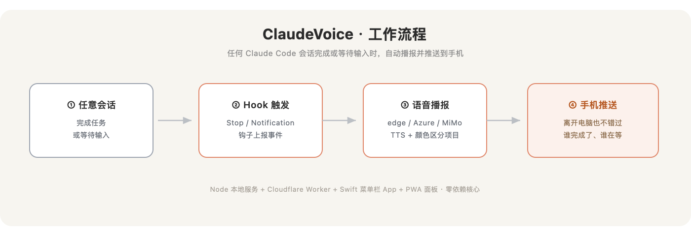

# ClaudeVoice · Claude Code 全局语音通知台


当任何一个 Claude Code 项目**完成任务**或**需要你确认 / 等待输入**时，你开着的这个网页会：

- 🔊 **自动语音播报**（小米 MiMo TTS）—— 准确告诉你「是哪个项目、现在要做哪一步」；
- 🎨 **按项目配色** —— 每个项目固定一种颜色，一眼分清；
- 🔁 **循环提醒** —— 需要你操作的事件，会反复播报 + 闪烁标签页标题，直到你点「我知道了」；
- 🖥️ **浏览器系统通知** —— 即使切到别的标签页也能弹窗提醒。

对**所有项目全局生效**：装一次，之后每个 Claude Code 会话都会自动接入。



> 界面是「深空信号台」主题：星场背景、星际穿越式提醒音效（管风琴涌升 + 滴答时间动机 + 穿透泛音）、说话时声波跳动。

## 声音怎么分配

- **尊称你的名字**：播报会喊你的名字（`.env` 里 `USER_NAME=你的名字`，可选 `USER_ALIASES=老大,阿伟` 加几个备用称呼随机轮换），措辞和语气**每次随机**，不死板。
- **不同项目不同音色，男女分开**：用 `mimo-v2.5-tts` 的 8 个音色——女声 `Mia / Chloe / 茉莉 / 冰糖`，男声 `Dean / Milo / 白桦 / 苏打`。每个项目按名字稳定分到一个，相邻项目男女交替。
- **英文发音**：用 v2.5 + 英文音色（Mia/Chloe/Milo/Dean）+「按整词美式发音、不逐字母拼读、不按拼音」指令。
- **项目名：中文显示名 + TTS 读音分离**（零配置）。语音里真正会被念出来的英文只有两处——项目名 + 工具名（transcript 内容只在屏幕显示、不朗读），所以这两处一管住就准：
  - 已知项目内置「中文名 + 读音」种子（见 `server.js` / `cloudflare/src/worker.js` 的 `DEFAULT_PROJECTS`）：屏幕显示中文名、语音念读音。例：`api-service` 显示「接口服务」念「API Service」。
  - 未知项目自动拆词：`MyCoolApp2025→My Cool App 2025`，工具名 `WebFetch→Web Fetch`，让英文音色读得对。
  - 想自定义：在 `projects.json` 写 `{"键":{"name":"中文显示名","say":"TTS读音","voice":"Dean","color":"#34d399"}}`（`name` 屏幕显示、`say` 语音念的；缺 `say` 就用 `name`，缺 `name` 就自动拆词）。
- **试听 / 改音色**：面板「🎙️ 音色中心」可逐个试听 8 个音色、给每个项目单独指定音色（存浏览器本地）。

---

## 工作原理

```
 Claude Code (任意项目)
   │  Stop / Notification 事件（全局 hook）
   ▼
 hook.js ──POST /hook──►  server.js  ──SSE──►  网页面板（自动播报 + 配色）
                            │
                            └──POST /tts──►  小米 MiMo TTS（API key 只在服务端）
```

- **触发**：用 Claude Code 的全局 hooks。`Stop` = 任务完成；`Notification` = 等待你输入 / 请求授权。
- **服务端**（`server.js`，纯 Node 内置模块，无需 `npm install`）：接收事件、SSE 实时推送、代理 TTS。
- **网页**（`public/index.html`）：单文件，连 SSE、用 Web Audio 自动播报、按项目 hash 配色。
- **TTS key 不出服务端**：网页只调本地 `/tts`，服务端再去调小米，key 不暴露在前端。

---

## 快速开始（本机）

```bash
cd /Volumes/ProjectsAPFS/CLAUDEVOICE

# 1) 填入小米 MiMo 的 key（platform.xiaomimimo.com）
#    编辑 .env 里的 MIMO_API_KEY=

# 2) 安装全局 hooks（会自动备份你的 ~/.claude/settings.json）
node setup.js

# 3) 启动服务
node server.js          # 或 npm start

# 4) 浏览器打开
open http://localhost:8787
#    点「启用语音播报」，保持页面开着即可。
```

之后随便在哪个项目里用 Claude Code，完成或等待时这个页面就会自动播报。

> **首次必须点一次「启用语音播报」**：浏览器规定，没有用户手势不允许自动播放声音。每次刷新页面后都要再点一次。

---

## 配置（`.env`）

| 变量 | 说明 |
|---|---|
| `PORT` | 服务端口，默认 `8787` |
| `HOST` | 监听地址，默认 `0.0.0.0`（便于隧道访问）|
| `MIMO_API_KEY` | 小米 MiMo 开放平台 key（**必填**）|
| `MIMO_MODEL` | `mimo-v2-tts`（默认）或更新的 `mimo-v2.5-tts` |
| `MIMO_VOICE` | `mimo_default` / `default_zh` / `default_en` |
| `HOOK_SECRET` | hook → 服务的共享密钥，`setup.js` 自动生成，勿手填 |
| `DASH_TOKEN` | **放公网时务必设置**。设了之后面板 / SSE / TTS 都要 `?token=该串` 才能访问 |

### 给项目起名字 + 固定颜色（可选）

把 `projects.example.json` 复制为 `projects.json`：

```json
{
  "my-web-app": { "name": "我的网站", "color": "#34d399" },
  "api-service": { "name": "接口服务", "color": "#fb7185" }
}
```

键是项目目录名（`cwd` 最后一段）。不配置时，名字取目录名、颜色按名字自动生成（每个项目稳定一种色）。

---

## 放到互联网上（手机也能收到）

服务跑在你的 Mac 上，hook 走本机 `127.0.0.1`（快且无需公网）。只需把**网页**暴露出去：

**方式一 · Cloudflare Tunnel（推荐，免费、有 HTTPS）**

```bash
brew install cloudflared
# 先在 .env 里设 DASH_TOKEN=一串随机字符，并重启 server.js
cloudflared tunnel --url http://localhost:8787
# 它会给你一个 https://xxx.trycloudflare.com 网址
# 手机 / 任意设备打开：  https://xxx.trycloudflare.com/?token=你的DASH_TOKEN
```

**方式二 · 部署到服务器**
把整个目录放到一台 VPS，`node server.js` 常驻（用 `pm2` / `systemd`）。这种情况下 hook 要发到公网地址：编辑 `~/.claude/claudevoice.json` 把 `url` 改成 `https://你的域名/hook` 即可（`secret` 不变）。建议同时设 `DASH_TOKEN`。

> ⚠️ **公网必设 `DASH_TOKEN`**。否则任何人都能访问你的面板、并通过 `/tts` 消耗你的 MiMo 额度。

---

## 卸载 / 关闭

```bash
node setup.js --remove      # 移除全局 hooks（其余 settings.json 配置不动）
```

或在网页上点「🔕 语音关」临时静音、「➡ 循环提醒关」关掉反复提醒。

---

## 常见问题

- **没声音**：先点过「启用语音播报」了吗？刷新后要重点。再看右上角是否「● 已连接」。
- **右上角一直「重连中」**：`server.js` 没在跑，或端口 / `token` 不对。
- **完成了却没提醒**：确认 `node setup.js` 装过 hooks（`~/.claude/settings.json` 里有 `hooks.Stop`）；新装后**新开**的会话才会带上 hook。
- **服务挂了会不会卡住 Claude**：不会。`hook.js` 永远快速、静默退出，连不上也不报错。

---

## 文件一览

| 文件 | 作用 |
|---|---|
| `server.js` | 服务端：收事件 / SSE / TTS 代理 |
| `hook.js` | Claude Code hook 调用它，转发事件（读 `~/.claude/claudevoice.json` 拿地址+密钥）|
| `setup.js` | 安装器：写 hooks、生成密钥、备份原配置 |
| `public/index.html` | 网页面板（单文件）|
| `.env` | 配置（含 key，已 gitignore）|
| `projects.json` | 可选：项目名 + 颜色映射 |

---

## 小米 MiMo TTS 接口速记

```
POST https://api.xiaomimimo.com/v1/chat/completions
Authorization: Bearer <key>
{
  "model": "mimo-v2-tts",
  "messages": [
    { "role": "user",      "content": "（可选）风格指令，如：用清晰提醒的女声播报" },
    { "role": "assistant", "content": "要合成的文本" }     // ← TTS 模型必须有 assistant 角色
  ],
  "audio": { "format": "mp3", "voice": "mimo_default" }
}
# 返回： choices[0].message.audio.data  = base64 音频
# 音色： mimo_default / default_zh / default_en
```
