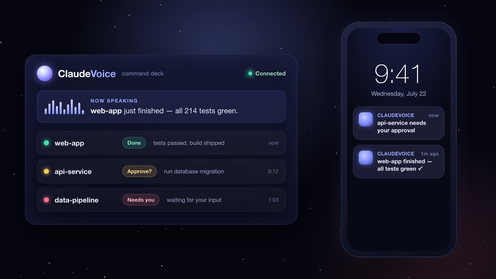

<div align="center">


<h1>ClaudeVoice</h1>

**Hear which Claude Code session just finished — or is quietly waiting on you.**
Global voice + phone alerts for every Claude Code project. Free, no API key, one install.

[](#-native-macos-app-optional)
[](#-quickstart-60-seconds)
[](#-quickstart-60-seconds)
[](#-quickstart-60-seconds)
[](LICENSE)
[](https://github.com/sunlinhua-dotcom/claudevoice/stargazers)

**English** · [简体中文](README.zh-CN.md)

</div>

---

## The problem

You start a Claude Code task, switch to Slack or another repo, and then… you wait. Two minutes later the agent has **finished** — but you don't notice for ten. Or worse, it **stopped to ask for your approval** and just sits there silently while you think it's still working.

The more agents you run in parallel, the worse it gets. You end up babysitting terminals instead of trusting them.

**ClaudeVoice turns every Claude Code session into something you can hear.** The moment any project finishes or needs you, it says so out loud — *which* project, and *what* it needs — and can ping your phone too.

<div align="center">

</div>

---

## Why you'll like it

- 🔊 **Speaks out loud, for free.** Uses Microsoft Edge neural TTS by default — **no API key, no account, no cost.** It tells you the project name and what happened ("api-service finished", "web-app is waiting for your approval").
- 🌐 **Global — install once, works everywhere.** Hooks into Claude Code at the `~/.claude` level, so **every project and every new session** is covered automatically. No per-repo setup.
- 🎨 **Tell sessions apart at a glance (and by ear).** Each project gets a stable color and its own voice, so three agents running at once never blur together.
- 📱 **Push to your phone (opt-in).** Deploy the included Cloudflare Worker for Web Push, or wire up Telegram / Feishu — get pinged even when your laptop is asleep-adjacent and you're across the room.
- 🖥️ **Optional native macOS menubar app.** Plays a cinematic chime + the spoken line even when no browser tab is open.
- 🛡️ **Never blocks Claude.** The hook always exits fast and silently — if the service is down, Claude Code doesn't even notice.
- 🧩 **Zero dependencies.** The server is pure Node built-ins. No `npm install`, nothing to audit.

---

## ⚡ Quickstart (60 seconds)

> Requires **Node ≥ 14** and the **Claude Code** CLI. No API key needed.

```bash
git clone https://github.com/sunlinhua-dotcom/claudevoice.git
cd claudevoice

# 1) Install the global hooks (backs up your ~/.claude/settings.json first)
node setup.js

# 2) Start the local service (zero dependencies, no npm install)
node server.js            # → http://localhost:8787

# 3) Open the panel and click "启用语音播报 / Enable voice"
open http://localhost:8787
```

That's it. Open Claude Code in **any** project — the next time it finishes or waits for you, the panel speaks. Keep the tab (or the [menubar app](#-native-macos-app-optional)) open.

> **Two things to know:** browsers only allow audio after a click, so you enable voice once per page load; and only **newly started** Claude Code sessions pick up the hooks.

---

## How it works

<div align="center">

</div>

- **Trigger** — Claude Code's global hooks fire on `Stop` (task done), `Notification` (waiting for you / asking permission), and `SubagentStop` (subtask done, silent by default).
- **`hook.js`** — forwards the event and exits immediately. It never blocks or errors out of Claude, even offline.
- **Server / Worker** — receives events, pushes them live over SSE, and synthesizes speech. The TTS engine chain is `edge → azure → mimo`: **Edge works out of the box for free**; Azure and Xiaomi MiMo are optional fallbacks if you add keys.
- **Panel / phone** — the web panel speaks and color-codes by project; the phone gets a push.

---

## 📱 Phone notifications

The local server drives the **voice panel**. To get notifications on your **phone**, pick one:

| Option | What you get | What it needs |
|---|---|---|
| **Cloudflare Worker + Web Push** | True background push (PWA), even with no tab open | Deploy `cloudflare/` + generate VAPID keys (`scripts/gen-vapid.mjs`), set `DASH_TOKEN` |
| **Telegram / Feishu** | A text ping to your chat | A bot token / Feishu app creds on the Worker |
| **Cloudflare Tunnel** | The live panel on your phone (voice plays when the tab is open) | `cloudflared tunnel --url http://localhost:8787` — no deploy |

> ⚠️ If you expose the panel publicly, **always set `DASH_TOKEN`** so only you can reach it and your TTS quota can't be drained.

---

## 🖥️ Native macOS app (optional)

A lightweight menubar app (`mac-app/`, **macOS 13+**) that plays the chime + spoken line without a browser tab, shows recent broadcasts, auto-starts at login, and includes experimental dictation + phone→Mac text relay.

```bash
cd mac-app && ./build.sh      # builds with swiftc (no Xcode project needed)
```

The app is self-signed for local use — on first launch, right-click → Open to get past Gatekeeper.

---

## 🤖 Drive Claude Code from your phone (optional · power users)

`bridge/` (**cc-bridge**) is a separate daemon that lets you run and steer Claude Code **from a Feishu private chat** — send a task by voice or text, approve tool calls with a tap on interactive cards, run several sessions at once, and get the produced files back. It needs your own Feishu app credentials. See [`bridge/README.md`](bridge/README.md).

---

## Configuration (`.env`)

`setup.js` writes a working `.env` for you. Everything below is optional:

| Variable | Meaning |
|---|---|
| `TTS_ENGINE` | Primary engine: `edge` (default, free) · `azure` · `mimo` |
| `USER_NAME` | Your name, so broadcasts address you |
| `PORT` / `HOST` | Server port (default `8787`) / bind address |
| `HOOK_SECRET` | Auto-generated shared secret (don't hand-edit) |
| `DASH_TOKEN` | **Set this before exposing publicly** — panel/SSE/TTS then require `?token=…` |
| `AZURE_SPEECH_KEY` / `_REGION` | Optional Azure TTS fallback |
| `MIMO_API_KEY` | Optional Xiaomi MiMo TTS fallback |

Give projects fixed names, colors, and voices by copying `projects.example.json` → `projects.json`:

```json
{
  "web-app":     { "name": "web app",  "color": "#46e0b0", "voice": "茉莉" },
  "api-service": { "name": "API",      "color": "#ffcd5b" }
}
```

---

## Good to know

ClaudeVoice is honest about what it is today:

- **macOS-first.** The core hook forwarding and web panel are cross-platform, but native banners, the menubar app, and the transcript-summarizing step are built for macOS.
- **Chinese-first voices.** The out-of-the-box voices and some UI are optimized for Chinese (the author's daily driver). The Edge engine supports English voices too — broader English polish is on the roadmap, and [PRs are very welcome](#contributing).
- **The tab (or menubar app) stays open** for voice to actually play; phone/Telegram/Feishu deliver a text ping, and voice plays when you open the app.
- **Edge TTS is unofficial.** It speaks to Microsoft's public "read aloud" endpoint — free and keyless, but with no SLA. Azure/MiMo are there as paid, stable fallbacks.

---

## Roadmap

- [ ] First-class English voice pack (Edge en-US) selectable per project
- [ ] One-command Worker deploy for phone push
- [ ] Linux / Windows native notifiers
- [ ] Packaged, notarized macOS app

Ideas and issues welcome — open one, or 👉 **[star the repo](https://github.com/sunlinhua-dotcom/claudevoice)** to follow along.

## Contributing

PRs and issues are welcome — English voices, other TTS backends, Linux/Windows support, and UI polish are great first contributions.

## License

[MIT](LICENSE) © 2026 Sun Linhua

<div align="center">

**If ClaudeVoice saves you from babysitting one more terminal, [give it a ⭐](https://github.com/sunlinhua-dotcom/claudevoice) — it genuinely helps.**

</div>
