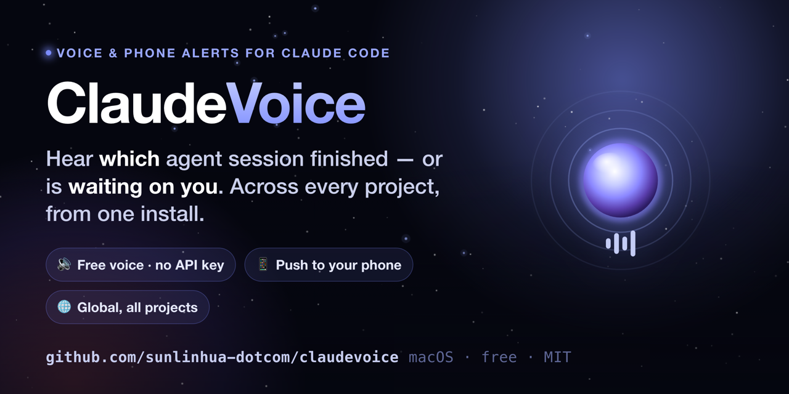
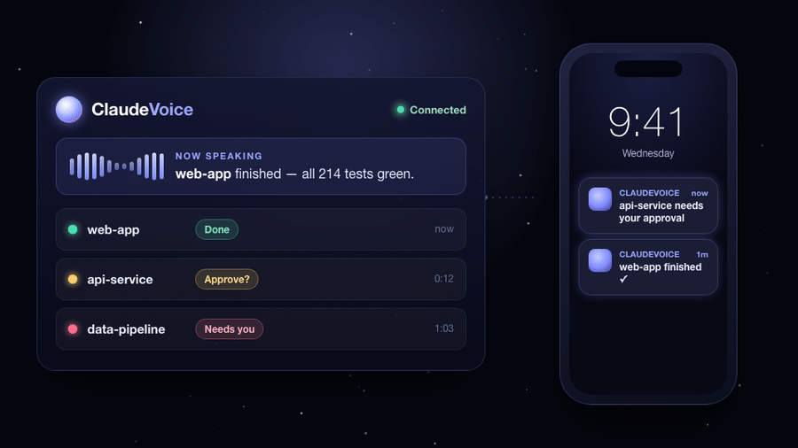
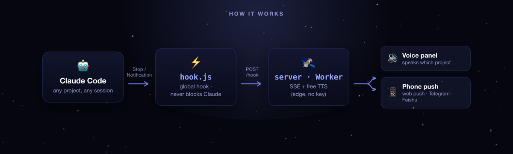

<div align="center">



<h1>ClaudeVoice</h1>

**一听就知道：哪个 Claude Code 会话刚做完，或者正在默默等你。**
给每一个 Claude Code 项目装上全局语音 + 手机提醒。免费、免 API key、装一次全局生效。

[](#-可选原生-macos-menubar-app)
[](#-快速开始60-秒)
[](#-快速开始60-秒)
[](#-快速开始60-秒)
[](LICENSE)
[](https://github.com/sunlinhua-dotcom/claudevoice/stargazers)

[English](README.md) · **简体中文**

</div>

---

## 痛点

你丢给 Claude Code 一个任务，转头去看 Slack 或者切到另一个仓库，然后就开始等。其实两分钟它就**做完了**，你却过了十分钟才发现；更糟的是，它**停下来等你授权**，安安静静地卡在那儿，而你还以为它在忙。

并行的 agent 越多，这事越折磨——你最后是在盯着一堆终端，而不是放心把活交给它们。

**ClaudeVoice 把每一个 Claude Code 会话变成「能听见」的。** 任何项目一旦完成、或者需要你，它当场说出来——是**哪个**项目、**要你做什么**——还能顺手推到你手机上。

<div align="center">

<br><sub>指挥台播报是哪个项目需要你，同时推到手机。</sub>
</div>

---

## 为什么你会喜欢

- 🔊 **开口播报，还免费。** 默认用微软 Edge 神经语音——**不用 API key、不用注册、零成本**。它会念出项目名和刚发生了什么（「接口服务 完成了」「web-app 在等你授权」）。
- 🌐 **全局——装一次，处处生效。** 挂在 `~/.claude` 这一层，所以**每个项目、每个新会话**都自动接入，不用逐个仓库配置。
- 🎨 **一眼、一耳就能分清会话。** 每个项目固定一种颜色 + 一个音色，三个 agent 同时跑也不会糊成一团。
- 📱 **推到手机（可选）。** 部署自带的 Cloudflare Worker 走 Web Push，或者接 Telegram / 飞书——人在房间另一头也能被叫住。
- 🖥️ **可选原生 macOS 菜单栏 App。** 不开浏览器标签页也能播放星际穿越式提示音 + 那句话。
- 🛡️ **永不卡住 Claude。** hook 永远快速、静默退出——服务挂了，Claude Code 都不会察觉。
- 🧩 **零依赖。** 服务端纯 Node 内置模块，无需 `npm install`，没有东西要审计。

---

## ⚡ 快速开始（60 秒）

> 需要 **Node ≥ 14** 和 **Claude Code** CLI。不需要任何 API key。

```bash
git clone https://github.com/sunlinhua-dotcom/claudevoice.git
cd claudevoice

# 1) 安装全局 hooks（会先自动备份你的 ~/.claude/settings.json）
node setup.js

# 2) 启动本地服务（零依赖，无需 npm install）
node server.js            # → http://localhost:8787

# 3) 打开面板，点一下「启用语音播报」
open http://localhost:8787
```

就这样。之后在**任意**项目里用 Claude Code——下次它完成或等你时，面板就会播报。保持标签页（或 [菜单栏 App](#-可选原生-macos-menubar-app)）开着即可。

> **两点要知道：** 浏览器规定没有点击就不给自动播声音，所以每次刷新页面要点一次「启用」；另外只有**新开的** Claude Code 会话才会带上 hook。

---

## 工作原理

<div align="center">

</div>

- **触发** —— Claude Code 的全局 hooks 在 `Stop`（任务完成）、`Notification`（等你输入 / 请求授权）、`SubagentStop`（子任务完成，默认静音）时触发。
- **`hook.js`** —— 转发事件后立即退出。永远不卡住、不报错打断 Claude，断网也一样。
- **服务端 / Worker** —— 收事件、用 SSE 实时推送、合成语音。TTS 引擎链是 `edge → azure → mimo`：**Edge 开箱即免费可用**，Azure 和小米 MiMo 是你填了 key 才启用的兜底。
- **面板 / 手机** —— 网页面板按项目配色并播报；手机收到推送。

---

## 📱 手机提醒

本地服务驱动的是**语音面板**。想在**手机**上收到提醒，三选一：

| 方式 | 你得到什么 | 需要什么 |
|---|---|---|
| **Cloudflare Worker + Web Push** | 真后台推送（PWA），不开标签页也能收 | 部署 `cloudflare/` + 生成 VAPID 密钥（`scripts/gen-vapid.mjs`），设 `DASH_TOKEN` |
| **Telegram / 飞书** | 一条文字提醒推到你的聊天 | 在 Worker 上填 bot token / 飞书应用凭证 |
| **Cloudflare Tunnel** | 手机上打开实时面板（标签页开着时会出声） | `cloudflared tunnel --url http://localhost:8787`，无需部署 |

> ⚠️ 一旦把面板暴露到公网，**务必设 `DASH_TOKEN`**，这样只有你能访问，TTS 额度也不会被人刷。

---

## 🖥️ 可选原生 macOS menubar App

一个轻量菜单栏 App（`mac-app/`，**macOS 13+**）：不开浏览器也能播放提示音 + 那句话，显示最近播报，登录时自启，还带实验性的语音听写 + 手机 → Mac 文本回传。

```bash
cd mac-app && ./build.sh      # 用 swiftc 直接编译，无需 Xcode 工程
```

App 是本地自签名的——首次启动右键 → 打开，绕过 Gatekeeper 即可。

---

## 🤖 用手机远程指挥 Claude Code（可选 · 进阶）

`bridge/`（**cc-bridge**）是一个独立常驻进程，让你**在飞书私聊里**直接跑和操控 Claude Code——语音或文字丢任务、在交互卡片上一键批准工具调用、多会话并行、产物文件自动回传。需要你自己的飞书自建应用凭证。见 [`bridge/README.md`](bridge/README.md)。

---

## 配置（`.env`）

`setup.js` 会帮你写好一份能直接跑的 `.env`。下面都是可选项：

| 变量 | 含义 |
|---|---|
| `TTS_ENGINE` | 首选引擎：`edge`（默认，免费）· `azure` · `mimo` |
| `USER_NAME` | 你的名字，播报时会称呼你 |
| `PORT` / `HOST` | 服务端口（默认 `8787`）/ 监听地址 |
| `HOOK_SECRET` | 自动生成的共享密钥（别手填） |
| `DASH_TOKEN` | **放公网前先设**——设了之后面板 / SSE / TTS 都要 `?token=…` |
| `AZURE_SPEECH_KEY` / `_REGION` | 可选 Azure TTS 兜底 |
| `MIMO_API_KEY` | 可选小米 MiMo TTS 兜底 |

想给项目固定名字、颜色、音色，把 `projects.example.json` 复制成 `projects.json`：

```json
{
  "web-app":     { "name": "我的网站", "color": "#46e0b0", "voice": "茉莉" },
  "api-service": { "name": "接口服务", "color": "#ffcd5b" }
}
```

---

## 老实说

ClaudeVoice 对自己现在的样子不藏着掖着：

- **macOS 优先。** hook 转发和网页面板是跨平台的，但原生横幅、菜单栏 App、完成说明的总结翻译这些是按 macOS 做的。
- **中文优先的音色。** 开箱音色和部分 UI 是按中文打磨的（作者自己天天在用）。Edge 引擎本身支持英文音色，更完整的英文体验在路线图上，[非常欢迎 PR](#参与贡献)。
- **标签页（或菜单栏 App）要开着**语音才真正出声；手机 / Telegram / 飞书给的是文字提醒，语音在你打开 App 时播放。
- **Edge TTS 是非官方的。** 它调的是微软公开的「朗读」端点——免费免 key，但没有 SLA。Azure / MiMo 作为付费但稳定的兜底放在那儿。

---

## 路线图

- [ ] 一等公民级英文音色包（Edge en-US），可按项目选择
- [ ] 一条命令部署 Worker 开手机推送
- [ ] Linux / Windows 原生通知
- [ ] 打包、公证过的 macOS App

欢迎提想法和 issue，或者 👉 **[给个 star](https://github.com/sunlinhua-dotcom/claudevoice)** 一起跟进。

## 参与贡献

欢迎 PR 和 issue——英文音色、其他 TTS 后端、Linux/Windows 支持、UI 打磨，都是很好的切入点。

## 许可

[MIT](LICENSE) © 2026 Sun Linhua

<div align="center">

**如果 ClaudeVoice 让你少盯一个终端，[给它点个 ⭐](https://github.com/sunlinhua-dotcom/claudevoice) —— 真的会帮到我。**

</div>
